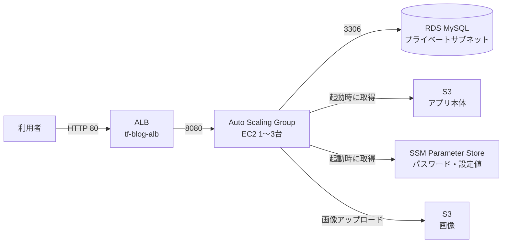

# AWS ブログインフラ（Terraform）

AWS 東京リージョンに構築した、Go 製ブログアプリ用の 3 層 Web インフラです。
最初は AWS コンソールで手作業で構築し、その後 Terraform でコード化しました。

## 構成図



- リージョン：ap-northeast-1（東京）、2 AZ（1a / 1c）構成
- ALB → EC2（Auto Scaling, 最小1 / 最大3）→ RDS MySQL
- 投稿データは RDS、画像は S3 に保存し、**サーバーには状態を持たせない**設計

## 設計のポイント

| 項目 | 内容 |
| --- | --- |
| サーバーは使い捨て | 起動時のユーザーデータで S3 からアプリを取得し、systemd で自動起動。AMI を手作業で作らない |
| 秘密情報の分離 | DB 接続情報・管理者パスワードは SSM Parameter Store（SecureString）で管理し、コードに含めない |
| 最小権限 | EC2 には IAM ロールを付与。対象バケット・パラメータへの必要な操作だけを許可。アクセスキーは不使用 |
| セキュリティグループの連鎖 | インターネット → ALB(80) → Web(8080, ALB からのみ) → RDS(3306, Web からのみ) |
| 自動復旧 | ELB ヘルスチェック（`/health`）で異常インスタンスを自動交換 |
| オートスケーリング | 平均 CPU 50% のターゲット追跡。負荷テストで 1→3 台への拡張と縮小を確認 |
| IMDSv2 | メタデータへのアクセスはトークン必須に設定 |

## ファイル構成

| ファイル | 役割 |
| --- | --- |
| `main.tf` | プロバイダー設定 |
| `data.tf` | 既存リソース（VPC・サブネット・RDS・IAM ロール・最新 AMI）の参照 |
| `security.tf` | ALB / Web 用セキュリティグループ、RDS への接続許可ルール |
| `compute.tf` | 起動テンプレート、ターゲットグループ |
| `alb.tf` | ALB、リスナー、Auto Scaling グループ、スケーリングポリシー |
| `userdata.sh` | 起動時にアプリを自動セットアップするスクリプト |
| `variables.tf` | 変数定義（SSH 許可 IP など） |
| `outputs.tf` | 出力値（ALB の URL など） |

VPC・RDS・S3・SSM・IAM ロールはコンソールで作成済みのため、Terraform では `data` で参照するのみとし、誤って削除・変更しないようにしています。

## 使い方

```bash
# 1. 自分の IP を設定（このファイルは .gitignore 済み）
echo 'my_ip = "x.x.x.x/32"' > terraform.tfvars

# 2. 実行
terraform init
terraform plan    # 変更内容を必ず確認
terraform apply
```

## 主なトラブルシューティング

**1. Auto Scaling で起動したインスタンスにパブリック IP が付かない**
手動作成時はコンソールが自動で有効にしていた設定が、起動テンプレートには含まれていなかった。テンプレートで明示的に指定して解決。

**2. ヘルスチェック失敗によるインスタンスの再作成ループ**
ASG のアクティビティログ → SSH → `curl -I localhost` で 403 を確認。AMI 作成時に表示用ファイルが無かったことが原因。個別サーバーではなく、起動方法（ユーザーデータ）側を修正。

**3. Terraform 移行後、新環境でのみ管理者ログインに失敗**
旧環境との違いは「パスワードの取得元」のみと判断。パスワードを画面に出さずに **SHA-256 ハッシュで比較**し、SSM の値の誤登録を特定。値を修正後、インスタンスリフレッシュで反映。ユーザーデータは初回起動時のみ実行されるため、設定変更にはサーバー交換が必要という点を学んだ。

**4. Terraform とスケーリングポリシーの競合**
ポリシーが台数を 1 台に減らすと、Terraform がコード上の 2 台に戻そうとする。`lifecycle { ignore_changes = [desired_capacity] }` で台数はポリシーに任せ、それ以外の設定を Terraform で管理するよう役割を分けた。

## AI の活用について

本プロジェクトでは、設計方針の検討・コード作成・トラブル調査に生成 AI（Claude）を活用しました。
AWS コンソールでの構築作業、動作検証、障害の切り分けは自分で行い、各設定の意図を説明できるよう学習しながら進めています。

## 今後の予定

- 独自ドメイン + HTTPS（ACM）
- GitHub Actions による自動ビルド・デプロイ
- Go アプリのソースコード公開
